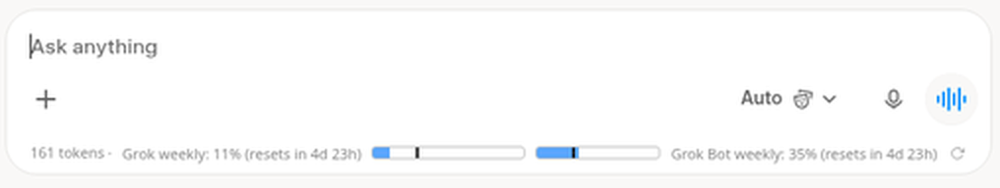
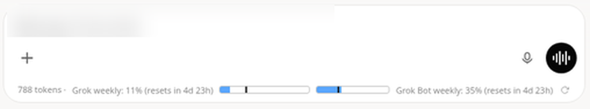
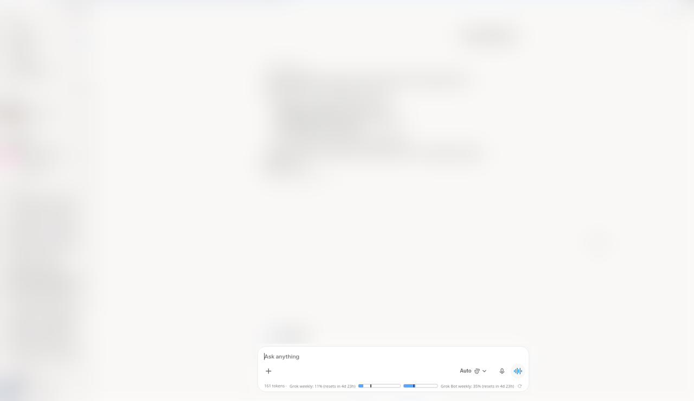
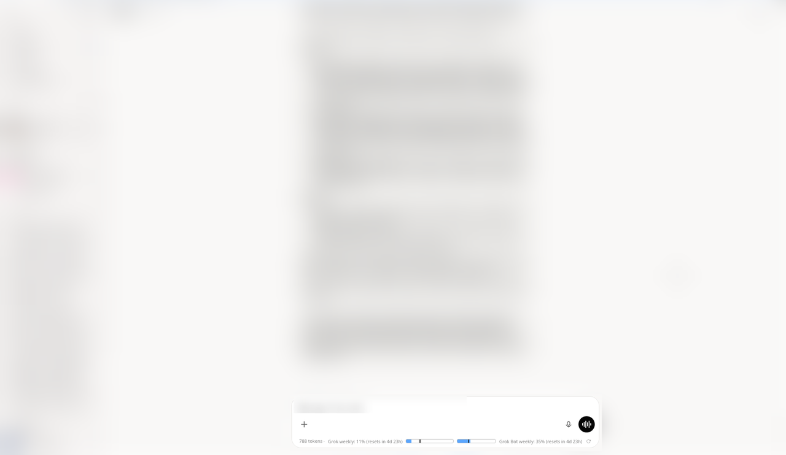

# Grok Token Counter

A small Chrome extension that shows your Grok usage and an approximate token count right inside the grok.com chat box.

Unofficial, not affiliated with xAI.

## What it shows

- An estimated token count for the open conversation (normal chats and Grok Bot chats).
- Grok weekly usage: percent used and time until reset. It should work on any Grok plan that has a weekly limit.
- Grok Bot weekly usage, with its own reset time.

Hover a bar to see the exact reset time and when the numbers were last updated. The ↻ button refreshes them.

## Screenshots

The strip sits at the bottom of the chat box. In a normal Grok chat:

In a Grok Bot chat:

Where it sits on the page (everything except the chat box is blurred on purpose):

| Grok chat | Grok Bot chat |
|---|---|
|  |  |

## Reading the strip

From left to right:

- **`161 tokens`**: estimated tokens in the open conversation, counting both your messages and Grok's replies. It updates as new messages come in.
- **`Grok weekly: 11% (resets in 4d 23h)`**: how much of the weekly Grok limit you've used, plus a bar. The thin dark line on the bar marks how far through the week you are, so if the blue fill is ahead of the line you're using it faster than the limit allows on average.
- **`Grok Bot weekly: 35%`**: the same for Grok Bot, with its own reset time.
- **↻**: refresh both numbers now.

## Install

1. Download the zip from the latest release and unzip it.
2. Open `chrome://extensions` and turn on Developer mode.
3. Click "Load unpacked" and pick the unzipped folder.
4. Reload grok.com.

To update, unzip the new version over the same folder and hit the reload icon on the extension card.

## How it gets the numbers

- Grok weekly usage comes from the same billing endpoint the grok.com settings page uses.
- Grok Bot usage comes from grok.com's bot WebSocket (`bot.usage`), checked on page load and every 5 minutes.
- If either of those fails, it falls back to reading Settings > Usage when you open it.
- Tokens are counted locally with the o200k tokenizer from gpt-tokenizer. Grok uses a different tokenizer, so treat the number as a rough estimate.

Everything stays in your browser. The extension only talks to grok.com, using your existing session.

## Uninstall

Remove it from `chrome://extensions`. It doesn't store anything outside the browser, so there's nothing else to clean up.

## Troubleshooting

- **Nothing shows up:** check the extension is enabled, then reload the grok.com tab. The strip only appears on chat pages.
- **"no data yet":** you may be signed out, or grok.com changed an internal API. Open Settings > Usage once; the extension can read the numbers from there.
- **Token count looks off:** it's an estimate using a different tokenizer than Grok's, and it only counts messages loaded on the page.

## Changelog

- **0.6.5**: English-only interface and code comments.
- **0.6.4**: plan-neutral wording, README cleanup.
- **0.6.3**: conversation token counter at the start of the strip, for both Grok and Grok Bot chats.
- **0.5.2**: Grok weekly and Grok Bot weekly bars in the chat box, Grok Bot data fetched in the background.

## Notes

- These are internal grok.com APIs, so they can change without warning. If the bars say "no data yet", that's probably what happened.
- The token count can be moved: run `localStorage.setItem('gtcBadgePos', 'right')` (or `'left'`, or `'strip'`, the default) in the grok.com console and reload.
- Debug logging is off. Turn it on with `localStorage.setItem('gtcDebug', '1')`.
- Older version without the token counter: [v0.5.2](https://github.com/KeyMagic24711/grok-token-counter/releases/tag/v0.5.2).

## Credits

- The usage bar UI is adapted from [Claude Token Counter](https://github.com/kr1shnasomani/claude-token-counter) (MIT).
- The credits endpoint decoding is based on [Grok Usage Watch](https://github.com/JoshuaWang2211/grok-usage-watch) (MIT).
- Tokenizer: [gpt-tokenizer](https://github.com/niieani/gpt-tokenizer) (MIT).

## License

MIT. The third-party license texts are in `LICENSE-claude-token-counter` and `LICENSE-grok-usage-watch`.
